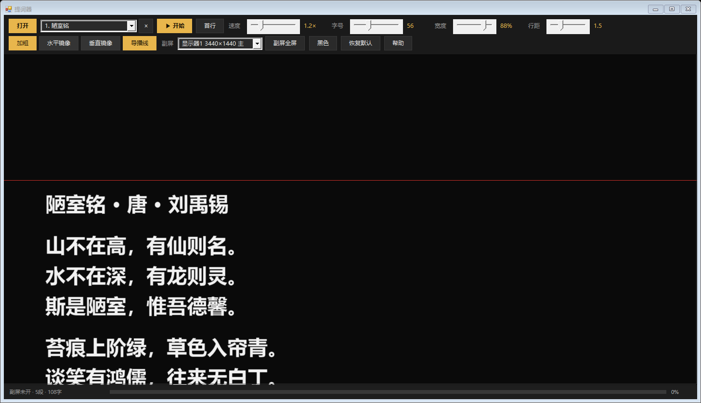

<div align="center">

# TiCi — Teleprompter

**Dual-screen · single-file .exe · zero dependencies · adaptive UI**


[简体中文](README.md) · [English](README.en.md)

</div>

---

## What it is

A small teleprompter for live recording, conferences and classrooms:

- **Primary screen** — a compact control bar plus a live, editable preview
- **Second screen** — fullscreen, borderless, menu-free, text only
- Both windows share a single scroll state, so the preview and the output
  can never drift apart.

The whole app is a **59 KB single executable**. No runtime to install, no
network access, no registry writes — copy it to a USB stick and double-click.



## Requirements

| Item | Requirement |
| --- | --- |
| OS | **Windows 7 SP1 / 8.1 / 10 / 11** (32-bit and 64-bit) |
| Runtime | .NET Framework **4.0** or later |
| Dependencies | None |
| Privileges | Standard user (no admin needed) |
| Displays | Works with one screen; **two screens recommended** |

### Windows 7 notes

It runs on Windows 7 SP1 **provided .NET Framework 4.x is installed**
(Windows 7 ships with 3.5 only). The app targets `.NETFramework,Version=v4.0`
and references only `mscorlib`, `System`, `System.Drawing` and
`System.Windows.Forms` — no .NET 4.5+ facade assemblies.

The build is verified on Windows 10/11; the Windows 7 conclusion is based on
the static evidence above and has **not** been validated on real Windows 7
hardware. Test on a spare machine before production use.

## Usage

1. Download `TiCi.exe` from [Releases](../../releases)
2. Run it — the control bar appears on the primary screen
3. Pick the target display in the **副屏** dropdown
   (the first non-primary screen is preselected)
4. Click **副屏全屏** — the second screen becomes a plain text canvas
5. Open a script and press `Space` to start scrolling

Click the preview to edit the script in place; `Ctrl+Enter` saves, `Esc` cancels.

### Keyboard

| Key | Action |
| --- | --- |
| `Space` | Play / pause |
| `↑` / `↓` | Faster / slower |
| `←` / `→` | Scroll up / down manually |
| `Home` | Back to the first line |
| `Tab` | Script list |
| `1` / `3` | Previous / next script |
| `2` or `F11` | Toggle the second-screen output |
| `M` | Toggle horizontal mirror |
| `F2` | Edit current script |

A USB foot pedal is just a keyboard — bind its key to `Space` and it works
out of the box, no driver needed.

## Build

No Visual Studio, no .NET SDK — only the `csc.exe` shipped with Windows:

```powershell
powershell -ExecutionPolicy Bypass -File src\build.ps1
# -> dist\TiCi.exe
```

Or open `src/TiCi.csproj` in Visual Studio / build with MSBuild.

## Privacy

Settings and scripts live in `提词器数据.txt` next to the executable.
The app never touches the network, collects nothing, and leaves no services
behind. Delete the folder to uninstall completely.

## License

[MIT](LICENSE). Third-party credits: [NOTICE](NOTICE).
