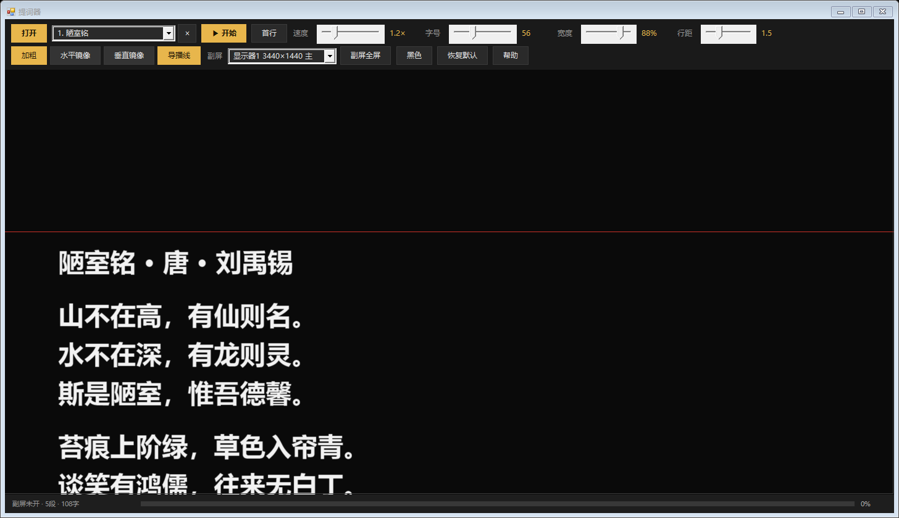
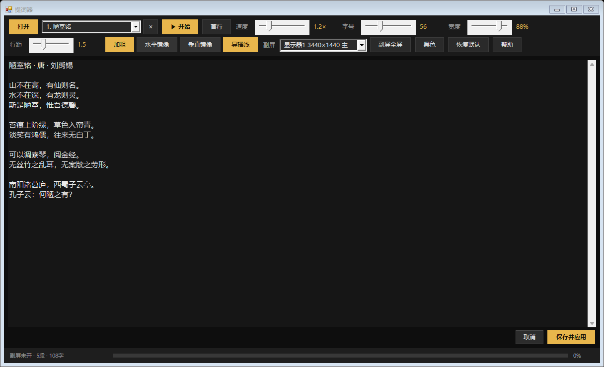

<div align="center">

# TiCi · 提词器

**双屏提词器 · 单文件 exe · 零依赖 · 界面自适应**


[简体中文](README.md) · [English](README.en.md)

</div>

---

## 这是什么

一个给现场录制、年会、发布会、课间播报用的**双屏提词器**：

- **主屏**：控制条 + 实时预览，预览区点一下就能直接改稿
- **副屏**：全屏、无边框、无菜单，只有文字，专门给镜头或分光镜看
- 两个窗口共用同一份滚动状态，**进度完全同步**

整个程序是一个 **59 KB 的单文件 exe**，不装运行时、不联网、不写注册表，
拷到 U 盘插到任何一台 Windows 上双击就能跑。



<table>
<tr>
<td width="50%"><br><sub>副屏输出（1920×1080 全屏纯文字）</sub></td>
<td width="50%"><br><sub>点预览区直接编辑，Ctrl+Enter 保存</sub></td>
</tr>
</table>

---

## 功能

| 功能 | 说明 |
| --- | --- |
| 双屏同步 | 主屏预览与副屏输出同源同帧，滚动偏移是同一个变量，不会对不上 |
| 自动换行 | 二分法精确测宽，中英混排、标点挤压都不会冲出屏幕 |
| 水平 / 垂直镜像 | 分光镜提词器用，可单独开也可叠加 |
| 导播线 | 红色基准线，提示当前阅读位置 |
| 实时预览 | 预览区就是副屏画面的等比缩略，改参数立刻可见 |
| 预览区直接编辑 | 点一下预览就能改稿，无需单独编辑窗口 |
| 稿件管理 | 多篇稿件切换、删除，支持 `.docx` / `.txt` / `.md` |
| 编码识别 | `.txt` 自动识别 UTF-8 / GBK，不会乱码 |
| 播放列表 | `Tab` 呼出，点选即切换 |
| 主题 | 黑色 / 深灰 / 白色 / 绿幕（绿幕用于后期抠像） |
| 键盘 / 脚踏板 / 遥控器 | 全部走标准键码，插上即用，无需驱动 |
| 记忆设置 | 参数与稿件存在 exe 同目录，跟着 U 盘走 |
| 防息屏 | 播放时自动阻止屏幕休眠 |

---

## 系统要求

| 项目 | 要求 |
| --- | --- |
| **操作系统** | **Windows 7 SP1 / 8.1 / 10 / 11**（32 位与 64 位均可） |
| **运行时** | .NET Framework **4.0** 或更高 |
| 依赖 | 无。不需要安装任何第三方库、不需要联网 |
| 权限 | 普通用户即可，不需要管理员 |
| 屏幕 | 单屏可用；**双屏为推荐用法**（主屏控制 + 副屏输出） |

### 关于 Windows 7

**可以运行，前提是系统已安装 .NET Framework 4.x。**

判断依据（本程序为 AnyCPU，仅引用 4.0 版本的框架程序集）：

| 检查项 | 结果 |
| --- | --- |
| CLR 运行时 | `v4.0.30319` |
| 程序集引用 | 仅 `mscorlib` / `System` / `System.Drawing` / `System.Windows.Forms` |
| 是否用到 4.5+ 新 API | 否（无 `System.Runtime`、`System.Threading.Tasks` 等门面程序集引用） |
| 目标框架声明 | `.NETFramework,Version=v4.0` |

> Win7 自带的是 .NET 3.5；4.x 需要单独安装（微软官方离线包，约 60 MB）。
> 另外 Win7 需为 **SP1**，这是 .NET Framework 4.x 的硬性前提。
> 说明：本程序在 Windows 10 / 11 上实测通过；Win7 的兼容性结论来自上述静态依据，
> **未在 Win7 真机上验证**，如果你要在生产环境用 Win7，建议先拿一台试跑。

---

## 快速开始

1. 到 [Releases](../../releases) 下载 `TiCi.exe`（下载后可改名为 `提词器.exe`，不影响运行）
2. 双击运行，主窗口出现在主屏
3. 顶部「副屏」下拉选择第二台显示器（默认已自动选中非主屏）
4. 点「**副屏全屏**」——副屏立刻变成纯文字画面
5. 点「打开」载入稿件，按 `空格` 开始滚动

> 首次运行若弹出「Windows 已保护你的电脑」，是因为 exe 未做数字签名，
> 点「更多信息」→「仍要运行」即可，只需一次。

---

## 使用

### 编辑文字

**直接点主窗口中间的预览画面**，它就变成可编辑文本框：

- `Ctrl + Enter` 或点「保存并应用」→ 生效
- `Esc` → 放弃修改

### 快捷键

| 按键 | 功能 |
| --- | --- |
| `空格` | 开始 / 暂停 |
| `↑` / `↓` | 加速 / 减速 |
| `←` / `→` | 手动向上滚 / 向下滚 |
| `Home` | 回到首行 |
| `Tab` | 打开稿件列表 |
| `1` / `3` | 上一篇 / 下一篇 |
| `2` 或 `F11` | 开关副屏输出 |
| `M` | 水平镜像开关 |
| `F2` | 编辑当前稿件 |
| `Esc` | 退出编辑 / 关闭下拉 |
| 鼠标滚轮 | 手动上下滚 |

### 脚踏板与遥控器

脚踏板本质是一个 USB 键盘：把它的按键设成**空格**，插上就能用。
遥控器按上表的键值发送即可，软件侧不需要任何配置。

---

## 构建

**不需要 Visual Studio，也不需要 .NET SDK**，只用 Windows 自带的 `csc.exe`：

```powershell
powershell -ExecutionPolicy Bypass -File src\build.ps1
# 产物: dist\TiCi.exe
```

指定输出位置：

```powershell
powershell -ExecutionPolicy Bypass -File src\build.ps1 -OutputPath D:\out\TiCi.exe
```

> 如果提示「禁止运行脚本」，就是上面这条带 `-ExecutionPolicy Bypass` 的命令；
> 也可以在 PowerShell 7（`pwsh`）里直接跑 `./src/build.ps1`。

也可以用 MSBuild / Visual Studio 打开 `src/TiCi.csproj` 编译。

### 自检

程序内置三个开发用自检入口，便于回归验证：

| 参数 | 作用 |
| --- | --- |
| `--render-test` | 把排版结果渲染成 PNG，输出到 `_selftest/` |
| `--smoke` | 启动并模拟开关副屏、按键，验证不崩溃 |
| `--ui-test` | 连续缩放、拖滑杆、点按钮，统计预览区是否变空白 |

---

## 目录结构

```
.
├─ src/                  源代码（C# 5，WinForms）
│  ├─ Program.cs         排版引擎、状态、滚动控制、副屏窗口
│  ├─ MainForm.cs        主窗口、预览区、工具栏
│  ├─ SelfTest.cs        自检与界面回归测试
│  ├─ AssemblyInfo.cs    版本与目标框架声明
│  ├─ app.manifest       DPI 感知与受支持 OS 声明
│  ├─ app.ico            程序图标
│  ├─ build.ps1          一键编译脚本
│  └─ TiCi.csproj        IDE / MSBuild 工程
├─ web/                  备用方案：单文件网页版（无需 exe）
├─ samples/              测试稿件
├─ docs/screenshots/     截图
├─ .github/              CI、Issue / PR 模板
├─ 说明.txt              给最终用户的简版说明
└─ CHANGELOG.md
```

---

## 数据与隐私

- 所有设置与稿件保存在 exe 同目录的 `提词器数据.txt`，**纯本地**
- 程序不联网、不采集任何数据、不写注册表、不留后台服务
- 删除文件夹即彻底卸载

---

## 常见问题

<details>
<summary>副屏没有出现文字</summary>

1. 检查「副屏」下拉是否选对了显示器；
2. 笔记本要按 `Win + P` 选「扩展」，不能是「复制」；
3. 确认点过「副屏全屏」。
</details>

<details>
<summary>点预览区没反应</summary>
播放中点击会先自动暂停再进入编辑，这是正常的。
</details>

<details>
<summary>文字太大 / 太小</summary>
拖「字号」滑杆，副屏与预览会立刻跟着变；换屏后不需要重新调，宽度按屏宽比例计算。
</details>

<details>
<summary>读取稿件失败</summary>
不支持老的 `.doc` 格式，请在 Word / WPS 里另存为 `.docx`。
</details>

<details>
<summary>换一台电脑</summary>
整个文件夹拷过去即可，设置和稿件都在 `提词器数据.txt` 里。
</details>

---

## 参与贡献

欢迎提 Issue 和 PR，请先看 [CONTRIBUTING.md](CONTRIBUTING.md) 与
[CODE_OF_CONDUCT.md](CODE_OF_CONDUCT.md)。安全问题请按 [SECURITY.md](SECURITY.md) 私下报告。

## 许可

[MIT](LICENSE)。第三方致谢见 [NOTICE](NOTICE)。

## 免责声明

本项目与任何商业提词器产品无关，代码为独立实现。请自行确认在
医疗、政务、教育等场景下的内容合规性。
